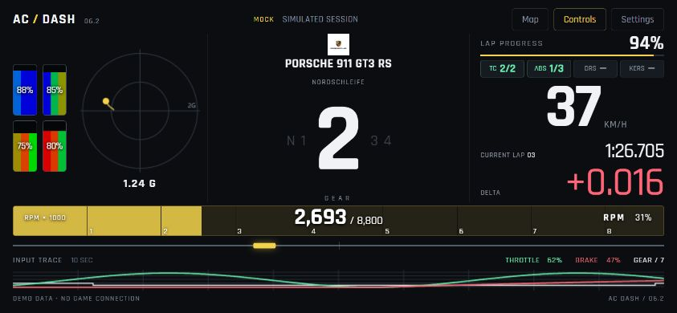
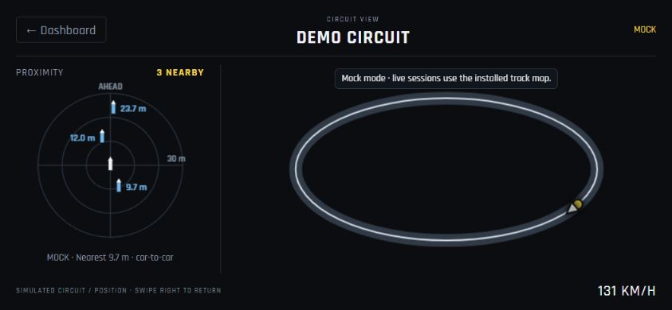
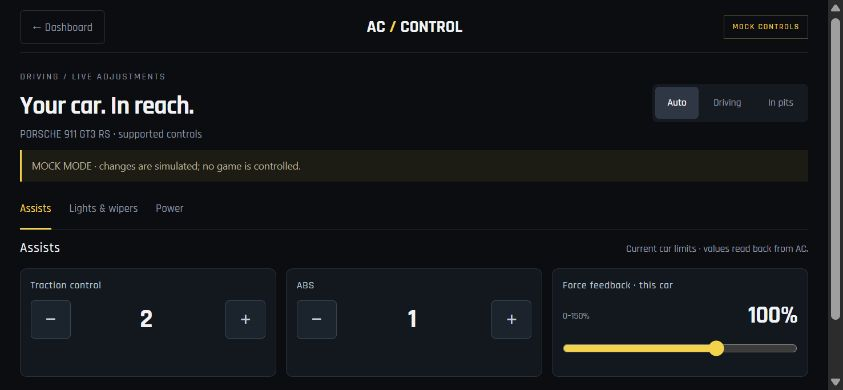

# AC Dash

A phone dashboard and control-panel prototype for **original Assetto Corsa**. A small Python server on the gaming PC streams telemetry to a browser on the same Wi-Fi, including iPhone Safari. No native phone app, Node server or cloud service is needed.



**Status:** experimental prototype, version 0.6.2. A runnable mock mode lets reviewers explore the interface without Assetto Corsa or CSP. Screenshots show simulated data.

## What it does

- Live speed, RPM/shift indicator, gear and valid neighbouring gears, pedals, steering, G-force and tyre readings.
- Current lap timing, recorded lap history and a distance-matched delta against a complete recorded reference lap.
- Track map and car-direction marker using installed layout assets and live world coordinates.
- Nearby-car radar with relative positions, directions and distances.
- Phone controls for supported car electronics, lights, pit plans, setup entries and session actions.
- Capability-based controls and live gear counts rather than a per-car catalogue.
- Explicit offline/unavailable states and a clearly labelled simulated mode.



## Try it without the game

Download this repository as a ZIP and extract it, or clone it:

```powershell
git clone https://github.com/HenryDrx/ac-dashboard.git
cd ac-dashboard
py -m pip install -r requirements.txt
py server.py --mock --port 8001
```

Open **http://localhost:8001** on the computer. On macOS/Linux use `python3` instead of `py` for mock mode.

To open it on a phone:

1. Connect the phone and PC to the same Wi-Fi.
2. Run `ipconfig` on Windows and find the active adapter's **IPv4 Address**.
3. In Safari open `http://<PC-IPv4-address>:8001`.
4. Keep Python running. On a trusted home network, allow Python through Windows Firewall for **Private networks**. Guest-network isolation or a VPN can prevent access.

The browser derives its WebSocket hostname and port from the page address. Safari's **Share → Add to Home Screen** makes it convenient to launch as a dashboard.

Navigation forms a horizontal strip: **map/radar — dashboard — controls**.

- Swipe **right** on the dashboard for map/radar; swipe left to return.
- Swipe **left** on the dashboard for controls; swipe right to return.
- Buttons and keyboard arrows also navigate. Page changes slide, with reduced-motion support.

## Connect to live Assetto Corsa

Live telemetry requires Windows, original AC and a driving session. The CSP Lua bridge enables the extra telemetry and controls.

1. Copy `csp-app/ACDashBridge` into `<Assetto Corsa>/apps/lua/`.
2. Start a fresh driving session. Open **AC Dash Bridge** in the in-game Lua-app list if needed.
3. Stop mock mode with Ctrl+C and run:

   ```powershell
   py server.py --port 8001
   ```

4. Refresh the phone page. Accelerate and brake: the displayed speed/RPM/pedals should follow the car.

If AC is installed somewhere the server cannot detect:

```powershell
py server.py --ac-root "D:\SteamLibrary\steamapps\common\assettocorsa" --port 8001
```

Maps and badges are read from the local game installation. They are not bundled in this repository. Missing assets or bridge data produce an unavailable state. Mock mode uses a simulated circuit and opponents rather than pretending to be live data.

## Controls

The available settings depend on the current car, installed equipment and session rules. The bridge discovers editable setup/pit entries rather than assuming every car supports the same adjustments.

| Group | Examples already wired |
|---|---|
| Aids and feedback | TC, ABS, brake bias, engine braking, per-car FFB |
| Power | DRS, KERS/ERS deployment, hybrid delivery/recovery modes, adjustable boost |
| Visibility | Headlights, high beams, flash, indicators/hazards, wipers |
| Pit plan | Fuel, compound, pressures, repair selections, available wing entries and presets |
| Setup | Editable car-defined entries such as tyres, alignment, brakes, suspension, differential or gearing |
| Session | Pause/resume, return to pits, go to track; supported offline restart/advance actions |

Commands are allowlisted, checked against current capabilities and acknowledged by the bridge. Displayed values use telemetry readback. See [the control inventory](docs/CONTROLS.md) for current scope and documented extension ideas.



## How it is built

**Assetto Corsa shared memory + CSP Lua → Python/aiohttp → local WebSocket → HTML/CSS/JavaScript browser UI**

| File | Responsibility |
|---|---|
| `server.py` | HTTP, WebSocket, mock generator and validated control endpoints |
| `ac_memory.py` | Read-only access to existing AC shared-memory mappings |
| `csp_bridge.py` | Exchange data through this app's own memory-mapped channels |
| `car_metadata.py` | Validate live gear/ranking data |
| `lap_delta.py` | Capture laps, persist references and interpolate elapsed time by track progress |
| `track_assets.py` | Resolve layout-specific maps and car badges safely |
| `csp-app/ACDashBridge/` | CSP telemetry, capability discovery and allowlisted game commands |
| `web/` | Responsive dashboard, map/radar and control screens |

Each browser has a bounded latest-only queue to avoid building a backlog of old telemetry. The server targets 50 updates/second; actual latency depends on the game, PC, Wi-Fi and phone. Controls use same-origin checks and a per-process token. This is a local-network prototype, not an internet-facing service.

## Verification and current limits

- 20 Python checks cover shared-memory fixtures, recording/delta persistence, map paths/configuration, control validation and latest-only queues.
- JavaScript checks cover navigation, gear neighbours, coordinate projection and ranking display updates.
- A synthetic Lua test covers startup ordering, command/readback, radar filtering and a race-position change from P12 to P3.
- Live telemetry and supported controls have been exercised during development. Automated fixtures are not a substitute for every car/session/device combination.

Run the Python checks on Windows:

```powershell
py -m unittest discover -s . -p "test_*.py"
```

Optional frontend/Lua development checks use Node (the app itself does not):

```powershell
npm install
npm test
```

Tyre colours use sourced palette/thermal information but are not an exact reproduction of Kunos' internal thresholds. Radar is a simplified position-based view, not predictive collision detection. Pit/setup changes remain subject to AC restrictions. Fresh live validation of the latest ranking change is still useful; the fixed P12→P3 regression is covered with fixtures.

The layout is currently fixed. Configurable widgets, setup-file management and broader controls are future work.

## References and assets

Interface references and implementation boundaries are documented in [SOURCES](docs/SOURCES.md). Rajdhani is supplied under the [SIL Open Font License](web/fonts/OFL.txt). Original AC track maps, car badges, game files, local lap recordings and credentials are not distributed here.
